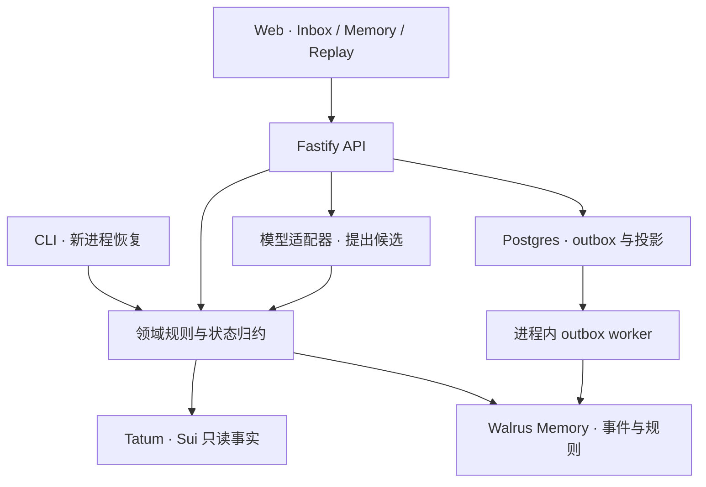

# 03 · 架构与工程决策

状态：设计规格，待执行。产品范围见02；所有第三方接口须通过G0。2026-10-26。

## 1. 选定架构

采用 **TypeScript + React/Vite + Fastify + PostgreSQL** 的单仓库。一个Node进程提供API和编译后的前端文件，并处理小规模数据库outbox任务；部署为一个Render Web Service和同区域Postgres。无需独立队列服务、微服务或自建向量库。界面使用现有无障碍组件与CSS tokens，不创造复杂设计系统。

选择Node 24 LTS兼容版本，G0读取依赖engines并锁定具体补丁；官方当前将24和22列为LTS，不能把Walrus仓库自己的开发环境版本当作所有消费项目的强制版本。[Node发布表](https://nodejs.org/en/about/previous-releases)。

图中CLI实际调用适配器取得记忆，再将事件交给纯领域模块；领域函数本身不进行网络IO。箭头描述依赖关系，不是把网络调用藏在纯函数内。

## 2. 三种状态分别承担什么

| 层 | 内容 | 是否可丢弃重建 |
|---|---|---|
| 链事实缓存 | Tatum返回的transaction/effects/balanceChanges、原始响应hash、时间 | 可再次只读查询；供应商历史保留不足时明确缺失 |
| Walrus持久事件 | 用户确认的纠正、规则版本、例外与必要的决策证据 | 应持久保存；按已确认manifest验证读取 |
| Postgres业务投影 | 当前active规则、列表、幂等请求、outbox/job状态、冻结manifest | 当前规则可由事件重放；outbox操作账及manifest须备份，不能随意删除 |

数据库不是“违背去中心化”。它处理幂等、并发与界面查询；本项目需要证明的是规则不被单一会话或某个模型供应商锁住。服务端、relayer和模型依赖如实列出，不能宣传为完全去中心化或无需信任。

## 3. 仓库布局

| 路径 | 职责 |
|---|---|
| `src/domain/` | 金额、交易观察、rule matcher、事件验证、纯reducer、state hash |
| `src/adapters/tatum/` | gRPC传输、状态归一化、字段与原始证据 |
| `src/adapters/memory/` | MemWal包装、job轮询、metadata枚举、manifest核对与恢复 |
| `src/adapters/model/` | 可替换模型，严格结构化rule proposal，不做事实裁决 |
| `src/server/` | HTTP路由、owner session、请求幂等、数据存储、outbox |
| `src/web/` | 三个主页面、状态组件、可访问性、错误恢复 |
| `scripts/` | doctor、mainnet验证、独立restore/replay、evidence导出 |
| `migrations/` | 版本化SQL迁移；发布时一次执行 |
| `tests/` | 领域、adapter contract、API、Playwright；live测试隔离 |
| `fixtures/` | 明确为synthetic的教学输入和评测案例 |
| `evidence/` | 实际执行后产生；公开文件先脱敏 |

只在构建确有需要时引入workspace packages。第一版不需要Turborepo、Nx或内部npm发布。

## 4. 唯一核心数据流

1. 输入Sui主网交易摘要与要观察的钱包。服务端经Tatum读取事实，归一化成功/失败、原子金额、资产类型、钱包方向以及可用gas信息。
2. 对同一观察读取当前已完成持久化且用户已确认的规则，纯函数返回分类、匹配范围、命中证据和需追问项。
3. 用户说“这次是工具费，以后同方向、同对手方、这个金额范围按工具费处理”。模型只生成待确认结构，界面显示具体范围，用户确认。
4. 在一个数据库事务中写event、稳定idempotency key、outbox与proposal状态；返回202。worker提交Walrus并保存jobId。UI显示“Saving to memory”。
5. job完成后写receipt、更新投影版本，UI显示“Remembered”。其他新会话此时才可以宣称规则可恢复。
6. 后续交易重跑相同规则引擎；决定中列出导致改变的eventId。反例、撤销和过期按同样事件协议处理。
7. 冷恢复使用全新进程、空投影、凭证与冻结manifest，从Walrus支持的中继器获取payload、验证集合及hash，再重建同一state。参见05。

## 5. 领域与模型的职责

**模型负责理解句子；确定性代码负责执行规则。** 金额、资产、交易状态来自链查询；分类用途来自用户授权的规则或逐笔标签。模型不能把转账摘要里的文本当作指令，不能改预算、扩大范围或发布记忆。

模型返回固定schema的 `RuleProposal`，不返回可执行代码/SQL/任意URL。适配器检查枚举、金额上下界、chain与coinType，缺字段就让界面提出最多一个有针对性问题。用户确认前没有active规则。

初始采用一个支持结构化输出的已授权API模型，通过`LLM_BASE_URL / LLM_API_KEY / LLM_MODEL`选择。dot在G0实测10条自然语言纠正，选已可用且足够准确的模型，不写死不存在的型号。ChatGPT订阅和dot对话不是应用API授权。模型不可用时保留显式表单纠正，UI标“Manual rule”；不能伪造AI回复。自然语言是P0体验，表单是降级路径。

## 6. 并发与幂等：只实现必要部分

- HTTP确认接口接受`Idempotency-Key`，数据库唯一约束为`(scope_id, operation_key)`；同键不同请求hash返回409。
- 新事件sequence由该scope的数据库事务锁分配；用`expectedVersion`防止同时确认覆盖规则。P0每scope只允许一个未决mutation，前一事件未done时不接受新的业务写入；memoryVersion只推进连续done前缀。
- outbox单worker租约；重启从未完成job继续。每事件一个稳定Walrus幂等键；不因HTTP超时认为写失败。
- 规则尚未durable时，可以在发起者界面显示预览，但正式投影不升级。
- 冻结评审数据时记录manifest的event集合、payload hash和state hash。公开访问不修改它。

不要求“分布式恰好一次”的夸张保证；实现数据库唯一性、稳定幂等键、可恢复job和完成后核对，列明剩余供应商失败场景。

## 7. 单owner与公开演示

P0只支持项目作者一个owner；公开观众无需钱包即可看预先公开的教学演示、对照和证据。作者通过受保护session执行真实链查询导入、确认、写入和恢复。公开演示使用冻结数据及本地session计算，不开放任意Walrus写入、不运行公众LLM接口。

作者入口使用服务端生成的短期session cookie（HttpOnly、Secure、SameSite）和来源/CSRF检查；操作密码/引导token经secret store设置，不放前端bundle或URL。不为此引入复杂多租户账号、邮箱、订阅收费系统。公开环境的demo owner账户只含教学事件，与未来真实个人数据账户分开。

## 8. 决策记录

| ADR | 决定 | 理由与退路 |
|---|---|---|
| A01 | 一个明确支出纠正场景 | Tatum交易事实与Walrus规则都改变核心行为；用户能理解收益 |
| A02 | 不做自动支付 | 当前获奖主线不依赖它；原支付样例有实质漏洞；支付另立验证分支 |
| A03 | gRPC为业务查询主路 | 避开已停用公共JSON-RPC；G0按Tatum当前endpoint/类型核验 |
| A04 | 采用官方MemWal SDK | 不重写nonce/Seal；默认SDK内部链读路径与业务Tatum路径分别披露 |
| A05 | 追加事件、可变投影 | 保存可解释历史同时支持修正和撤销；不声称字节永久或无法删除索引 |
| A06 | Postgres outbox | 解决重启丢job和内存Set去重缺陷；规模很小，不另建队列 |
| A07 | 冻结教学演示 + 受保护live验证 | 评委可操作，秘密和实际写入有边界；不会把演示重播说成live |
| A08 | 部署独立Node进程 | gRPC/SDK运行环境明确；不把需要后端秘密的产品交成静态网页 |

## 9. 尚未验证的工程风险及立即检验

| 风险 | 首个检验 | 失败处理 |
|---|---|---|
| 实际Tatum账户无需要的方法/历史数据 | G0查询最新checkpoint与一笔已知交易，记录HTTP/gRPC状态 | 修正供应商配置或挑可读的明确样本；不默默切别家声称Tatum |
| MemWal类型与网页不一致 | 固定0.1.9发布物及peer依赖，编译最小read/list/write contract | 读发行类型/变更记录，明确升级/降级，不打补丁猜字段 |
| 完整payload无法召回 | 专用demo账户、少量事件、精确manifest核对 | 未达完整恢复标失败；不从本地fixture补齐 |
| 一笔Sui PTB不是简单单向转账 | 从资产/地址净变化建立observation，复杂case拒绝推断 | 展示需要上下文，缩小第一版支持范围 |
| 体验只剩规则设置器 | 做自然语言纠正与“为什么改变”交互，并测理解成本 | 删无关看板，把第一次成功路径缩短 |

来源：[Sui迁移指南](https://docs.sui.io/develop/accessing-data/json-rpc-migration)、[Tatum gRPC](https://docs.tatum.io/reference/sui-grpc)、[Walrus生产实践](https://docs.wal.app/walrus-memory/sdk/production-readiness)、[Render Node部署](https://render.com/docs/deploy-node-express-app)。以上是选型依据，不是本项目实测记录。
