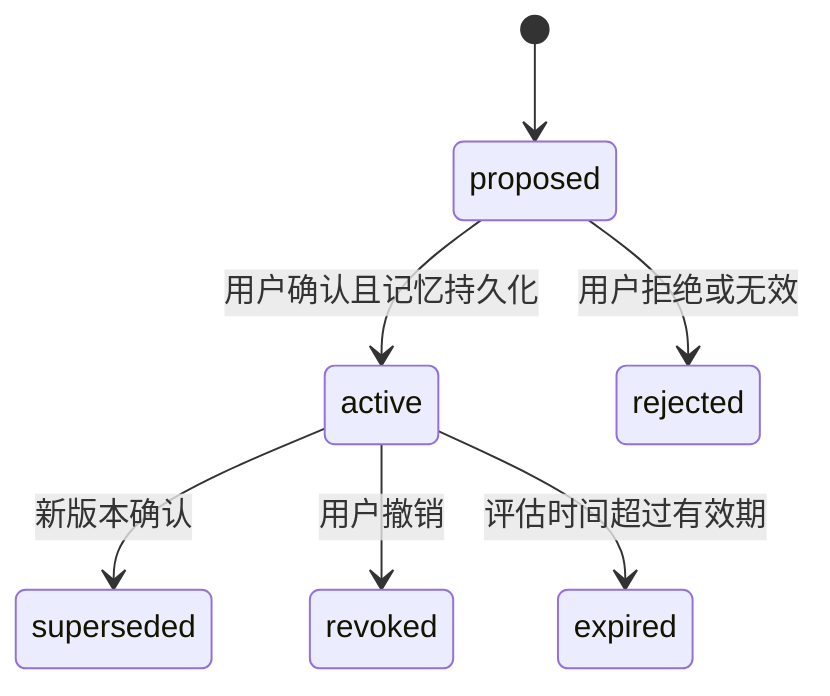

# 04 · 数据、状态与 API 契约

本文件定义 **RecallLedger 自己的接口**，不是MemWal或Tatum的原生SDK签名。第三方返回值只在adapter中映射；对应发布物见05/06。字段原型在 `contracts/domain-contracts.ts`，执行者仍须补Zod验证和迁移。

## 1. 分类和“未知”的含义

`classification`固定为：`needs_context | expense | internal_transfer | reimbursement | refund | income`。`expense`可另带`category: tools`等用户确认类别；category不取代classification。

| 分类 | 需要的依据 | P0如何计入工具费 |
|---|---|---|
| `needs_context` | 缺用途或规则冲突/失效 | 不计；单独展示未解释金额 |
| `expense` | 用户逐笔确认，或明确且适用的active规则 | 计入已分类工具费；仍标用户提供的业务含义 |
| `internal_transfer` | 用户明确拥有两端/该笔确认，不由同名推断 | 不计工具费 |
| `reimbursement` | 用户标明报销，第一版不实现垫付会计科目 | 独立列出，不算该用户工具费 |
| `refund` | 同资产、反方向、显式关联原支出且金额可核对 | 按关联金额抵减工具费，上限受原支出剩余额约束 |
| `income` | 用户确认收入属性 | 独立列出，不和支出混算 |

本项目是可解释支出分类工具，不声称提供完整会计账、税务判断或自动财务建议。净转账不等于消费。SUI手续费单列，不默认折算为USDC。不同coinType永不直接合计。

## 2. 交易事实和业务观察分离

`ChainTransactionEvidence`来自Tatum；`TransactionObservation`是用户选择的钱包视角；`ClassificationDecision`是使用某一版记忆得到的业务判断。

- 事实必须保留`transactionDigest`、network、成功/失败、checkpoint（可空）、查询时间、资产类型及原子金额。供应商不返回字段时保留null，不生成“看起来合理”的默认值。
- 一笔PTB可能影响多个地址和资产。净余额变化不能强行配对成每一笔付款。P0支持可以明确解释的简单转账；其他记录`complexity: complex`，请求上下文。
- 交易方向按被观察钱包和相应资产净变化确定，不仅看sender。负数出账、正数入账、零变化不视作支付。失败交易不得当已完成消费，但实际gas可另展示。
- transactionDigest是链身份，不是订单/用途证明。唯一观察键：`network + transactionDigest + walletRef + coinType`；重复导入不能重复计费。
- `dataOrigin`为`synthetic | live | recorded_live`。教学数据使用`fixture:*`标识，严禁构造成看似有效的主网digest。`live`只有实际查询成功后才能赋值。

## 3. 金额与时间

链上Evidence.balanceChanges.amountAtomic保留带符号净变化；normalizer先按观察wallet+coinType聚合，再提取direction，TransactionObservation.amountAtomic存非负绝对值。RuleScope的min/max也为非负原子单位字符串；不能拿负净变化直接比较5–30区间。所有金额计算用`BigInt`。小数输入通过资产decimals逐位转换，超精度拒绝而不是四舍五入。资产未知precision时显示原子值和“精度未确认”，不能假设所有USDC均为6位。

业务窗口采用明确的IANA时区。演示用户时区为`Asia/Shanghai`，事件使用UTC ISO8601保存；同输入对照必须固定`evaluatedAt`，防止“规则到期”被误认为记忆效果。缓存更新时间不参与policy state hash。

## 4. 规则模型

每条规则包含：稳定`ruleFamilyId`、唯一`ruleVersionId`、版本、status、chain、walletRef、counterpartyRef、coinType、direction、金额min/max、可选有效期、分类、category、来源eventId及用户确认。

P0匹配只支持固定字段合取（AND），不接收JavaScript、SQL、正则或任意URL。所有匹配维度必须显示在确认界面；未指定的维度不得静默变成“任意”。模型不能从一次确认推出所有同名商家、所有代币或所有钱包的规律。

规则状态：

`rejected/expired`是接口展示或派生状态；持久规则版本的status枚举保持`proposed|active|superseded|revoked`。expired由规则的有效期与evaluatedAt计算，不需每过一秒写新记忆。

### 决策优先级

1. 事实校验失败、交易失败或缺关键资产字段 → `needs_context`并给出具体原因。
2. 该observation已被用户明确标签/纠正 → 使用最新已确认标签。退款关联还须通过金额及关联验证。
3. 匹配active规则：同类结果可合并解释；不同classification/category的规则冲突 → `needs_context`，要求选定或修订，不能静默“最新获胜”。
4. 唯一无冲突有效规则 → 分类并记录所用ruleVersionId、memoryVersion、解释。
5. 没有匹配 → `needs_context`。

版本替代只在同一ruleFamilyId且明确`supersedesRuleVersionId`时生效。`recordedAt`、semantic relevance和数组顺序都不是规则优先级。查看既有条目时使用其已记录decision及后续显式correction；新输入才应用当前规则。撤销只改变未来判断，不能自动抹掉历史标签或原来按有效规则保存的decision；历史批量重算另列P2，必须显式选择并留痕。

因此M05的B虽由规则自动分类，其保存决定仍保留；M12撤销不会把B突然变成unknown。M10对B的已确认退款关联继续有效，演示工具费仍为A12+B12−D12=12。对全新的同类转账，M12之后则返回needs_context。

### 退款关联的后续修正

P0每个refund observation只允许一条有效关联，金额必须同时不超过该入账金额和原支出尚未退款余额。同一请求幂等返回原记录；重复关联到第二笔支出返回冲突，不能把12入账抵减两次得到24。更换关联必须显式取代旧关联。

汇总时重新核验关联目标的当前有效分类与资产。如果原支出后来被用户纠正为internal_transfer/reimbursement等非expense，原refund link派生为`needs_review`，暂不参与该类别抵减并展示原因；旧as-of回放保留原历史。如果仍是expense但category改变，退款随已确认目标归属同一category，不能在两个类别同时抵减。退款用途不能仅由反向转账推断。

## 5. 可移植事件

事件头：`schemaVersion:'1.0'`、`eventId`、`scopeId`、`sequence`、`kind`、`eventTime`、`recordedAt`、`inputRef`、`evidenceKind`、`payload`、`parentEventIds`、`previousEventHash`、`author`、`confirmation`。

| kind | payload的必备内容 | 改变当前规则？ |
|---|---|---|
| `preference_confirmed` | scope/timezone/asset display和用户选择 | 可改变偏好，不改变交易事实 |
| `observation_recorded` | 有标识的交易观察、事实来源、可用证据引用 | 否 |
| `label_confirmed` | observationId、classification、category、用户确认 | 改变单笔标签 |
| `rule_confirmed` | 完整规则、版本、适用范围、被替代版本 | 是 |
| `decision_recorded` | inputRef、memoryVersion、classification、matchedEventIds；若观察此前未存则附最小完整observation | 记录历史判断，不自动学习 |
| `correction_confirmed` | observationId、替代的decision/label、正确分类、理由 | 单笔纠正；不自动泛化 |
| `refund_link_confirmed` | refundObservationId、originalObservationId、coinType、amountAtomic、确认 | 改变关联汇总，不生成泛化退款规则 |
| `rule_revoked` | ruleVersionId、用户确认、原因 | 是 |

M01–M12具体故事以fixtures计划为准。事件中的`evidenceKind: synthetic`可以被真实写入主网；这只证明教学事件被持久化，不证明相应交易曾真实发生。链上真实观察用`mainnet_observed`并附查询证据。M05/M06/M11须分别包含B/C/E的必要观察值，不能只有指向本地fixture的ID；恢复规则、历史决定和汇总所需的全部业务字段必须可从远端事件获得。

fixture是教学计划，不能直接断言为`MemoryEvent`或`TransactionObservation`。构造器须把`eventType`映射到`kind`，把`outgoing/incoming`映射到`out/in`，把`assetRef`映射到明确的fixture资产标识，把`ownerRef`映射到`walletRef`；为事件补齐稳定ID、时间、连续sequence、引用和hash，为规则补齐明确的有效时间。原计划中的`plannedPayload`与`expectedState`分别是输入提示和测试断言，后者不能作为远端恢复数据的替代。所有转换先经本项目运行时schema验证，再交给领域引擎或Walrus适配器。

### 完整性与重放

- 稳定eventId和payload在首次提交前生成并持久保存；重试不改`recordedAt`。
- 对规范化JSON（RFC8785/JCS兼容）UTF-8 bytes做SHA-256，保存为独立`eventHash`（不放进被hash的event本体）。实际记忆正文为固定前缀`RecallLedger event v1\n`加规范化JSON，`textSha256`则hash包含前缀的完整实际写入文本。两者不能混用。使用成熟实现并跑标准测试向量；禁止靠普通`JSON.stringify`的偶然键顺序跨语言签名。
- `previousEventHash`使篡改/缺事件可检测；第一个事件为null，后续引用前一序号的`eventHash`。它是应用校验，不等于链上不可篡改时间证明。
- reducer仅接受schema有效、scope一致、序号连续、引用存在的完整集合；先按sequence排序，再逐一重放。重复eventId同hash忽略，不同hash直接失败。
- reducer输出规则版本/状态、标签、关联、偏好，以及已记录decision和必要observation投影；`stateHash`覆盖这些稳定业务字段，排除API时延、retrievedAt和UI状态。显式correction覆盖对应条目的当前分类，但保留旧decision作为历史。
- manifest确定预期集合。收齐它才能宣称恢复；不能用搜索返回总数估算完整性。

## 6. Postgres表和约束

| 表 | 主要字段 | 必须有的约束 |
|---|---|---|
| `scopes` | id, memory_account_id, namespace, last_allocated_sequence, last_durable_sequence, frozen_version | 单owner；namespace固定；每scope最多一个未决写入 |
| `observations` | id, unique_chain_key, normalized_json, raw_hash, origin | unique_chain_key唯一；origin强枚举 |
| `events` | event_id, scope_id, sequence, canonical_json, event_hash, text_sha256, durable_status | event_id唯一，scope+sequence唯一；payload不可原地改 |
| `memory_outbox` | event_id, operation_key, payload_hash, job_id, state, attempts, next_attempt_at, lease_until | operation_key唯一；同event只一个活跃job |
| `memory_receipts` | event_id, memory_id, job_id, blob_id, namespace, owner_address, status, end_epoch, verified_at | receipt对应event；blob不能作为秘密 |
| `rule_projections` | scope_id, rule_version_id, revision, projection_json | 从已durable事件产生 |
| `request_idempotency` | scope_id, operation_key, request_hash, response_json, status | 同键不同内容409 |
| `sessions` | hashed_session_id, role, expires_at | 不保存明文密码/登录token |
| `frozen_manifests` | manifest_version, manifest_json, manifest_hash, frozen_at | 冻结版本不可静默覆盖 |

所有服务端读取显式限定scope。虽然MVP单owner，也不能仅因为“没有多用户”就让公众写入owner的memory。

## 7. HTTP API v1

成功结构`{data, meta:{requestId,dataOrigin,memoryVersion}}`；错误`{error:{code,message,retryable,details},requestId}`。details经脱敏。读取不产生记忆；写入202返回operation/job，客户端轮询GET operation，避免按钮无休止转圈。

| 方法与路径 | 输入 | 输出/效果 | 访问 |
|---|---|---|---|
| `GET /api/health` | 无 | liveness、依赖状态摘要，不含secret | 公开 |
| `GET /api/demo` | 固定manifestVersion | 冻结教学数据、版本与标签 | 公开 |
| `POST /api/demo/replay` | 预定inputId、asOfSequence、memoryMode | 本地纯计算；不调用LLM、不主网写 | 公开，限流 |
| `POST /api/transactions/inspect` | digest、walletAddress | Tatum归一化observation+证据 | operator |
| `POST /api/classify` | observationId、memoryMode、evaluatedAt | 新输入决策及matchedEventIds；已有条目返回保存决定，不能静默历史重算 | operator |
| `POST /api/corrections/propose` | observationId、文字<=2000字符 | 结构化候选+缺失维度；无持久化 | operator |
| `POST /api/corrections/confirm` | correctionProposalId、observationId、expectedVersion | 202；只确认单笔纠正；规则另走rules/confirm | operator |
| `POST /api/rules/:id/revoke` | expectedVersion、reason | 202 撤销事件 | operator |
| `POST /api/refunds/link` | 两observationId、原子金额、expectedVersion | 202 显式关联事件 | operator |
| `GET /api/operations/:id` | id | pending/running/done/failed/unknown及重试建议 | operator |
| `GET /api/memory/timeline` | cursor | 事件/receipt/派生变化；无secret | operator；demo另投影 |
| `POST /api/memory/restore-check` | 冻结manifestVersion | 受限独立重放任务，返回完整性/缺失项 | operator |
| `GET /api/evidence/public` | manifestVersion | 经审阅公开的教学证据 | 公开 |

确认与撤销接口必须带幂等键；expectedVersion不符409，返回当前版本让用户重读，不能覆盖。自然语言proposal有有效期，确认前事实/当前规则变化就要求重新预览。

### 7.1 操作与事件的明确映射

下面命令接口与上表共同组成v1。inspect/classify/propose永远只是读取或预览；不得暗中写记忆。UI必须能产生全部演示事件，不能只有seed脚本能构建故事。

| 受保护的写命令 | 输入要点 | 产生事件 | 对应教学步骤 |
|---|---|---|---|
| `POST /api/preferences/confirm` | timezone、coinType、category、period、预算与提醒原子金额、expectedVersion | preference_confirmed | M01 |
| `POST /api/observations/import` | 服务端已核验的observation draft ID、expectedVersion | observation_recorded | M02/M09 |
| `POST /api/labels/confirm` | observationId、classification、category、确认、expectedVersion | label_confirmed | M03 |
| `POST /api/rules/confirm` | ruleProposalId、明确作用域确认、expectedVersion；可带supersedes | rule_confirmed | M04/M08 |
| `POST /api/decisions/record` | observationId、previewToken、expectedVersion | decision_recorded，必要时内含观察 | M05/M06/M11 |
| `POST /api/corrections/confirm` | 已保存条目、correctionProposalId、expectedVersion | correction_confirmed；只纠正该笔，不顺带激活规则 | M07 |
| `POST /api/refunds/link` | 新旧observationId、金额与显式确认 | refund_link_confirmed | M10 |
| `POST /api/rules/:id/revoke` | ruleVersionId、原因与expectedVersion | rule_revoked | M12 |

写命令统一返回202和`{operationId,eventIds,durableVersion,pendingSequence}`。所有链事实由服务端draft取回；客户端提供的金额和状态不能替代Tatum证据。previewToken绑定inputHash、policyVersion、evaluatedAt和有效期；保存decision前服务端重新计算并比对，有变化返回409重新预览。`Record / Save label / Remember this rule`分别触发上述命令；用户不需要知道事件kind。

### 7.2 连续持久化版本

P0采用最简单的串行策略：**每scope最多一个未完成mutation**。若序号n仍pending/unknown/failed，新的业务写入返回409 `MEMORY_PENDING`及原operationId；同一幂等键的重试返回原操作状态。只读查看、proposal和session预览继续可用。

`memoryVersion = last_durable_sequence`，只推进连续done的前缀；不能从“最大done序号”推算完整版本。outbox不会先处理n+1。前序终态失败时保持该scope写入blocked，检查是否已有blob、payload和job后按05恢复，不能跳过序号继续激活后续规则。测试必须覆盖n超时/重启期间n+1不能生效。

## 8. 错误码与UI反馈

| code | 含义 | UI动作 |
|---|---|---|
| `CHAIN_UNAVAILABLE` | Tatum不可用或超时 | 保留已有结果，显示时间和重试；不能改为success |
| `TRANSACTION_NOT_FOUND` | 查询不到，可能错误摘要/历史不可用 | 请核对摘要；不补fixture |
| `TRANSACTION_FAILED` | 链上执行失败 | 展示失败与可用gas；不计成功支出 |
| `RULE_CONFLICT` | 有效规则互相矛盾 | 展示两条作用域，请用户纠正 |
| `MEMORY_PENDING` | 已接受但未确认done | 继续查同job，按钮变“查看保存进度” |
| `MEMORY_WRITE_FAILED` | 终态失败 | 显示原因和受控重试；原payload/key保留 |
| `MEMORY_INCOMPLETE` | 恢复缺事件/多出冲突/hash不符 | 不宣称恢复成功，不应用部分规则 |
| `VERSION_CONFLICT` | 并发更新 | 重新加载当前版本 |
| `MODEL_UNAVAILABLE` | 无模型配置/服务失败 | 显示手动规则表单，保留原文字 |
| `SCOPE_NOT_CONFIRMED` | 泛化范围未获确认 | 停留在proposal，不调用Walrus |

## 9. 公开证据边界

公开教学fixture可包含可读业务标签；真实用户资料不进入公开repo。钱包公开地址不自动等于可任意暴露用户身份，演示只用已授权的演示地址。不能用普通hash匿名化邮箱/姓名后声称不可识别，也不能把唯一映射只留浏览器却宣传跨设备完整恢复。需要可移植的引用和规则内容放在同一受授权的加密记忆上下文；公开导出是单独的经过选择的教学视图。

规范依据：[RFC8785](https://www.rfc-editor.org/rfc/rfc8785)、[Walrus生产实践](https://docs.wal.app/walrus-memory/sdk/production-readiness)、[Walrus权限](https://docs.wal.app/walrus-memory/contract/ownership-and-permissions)。本文件的规则引擎、API路径和表结构均为本项目设计决定。
